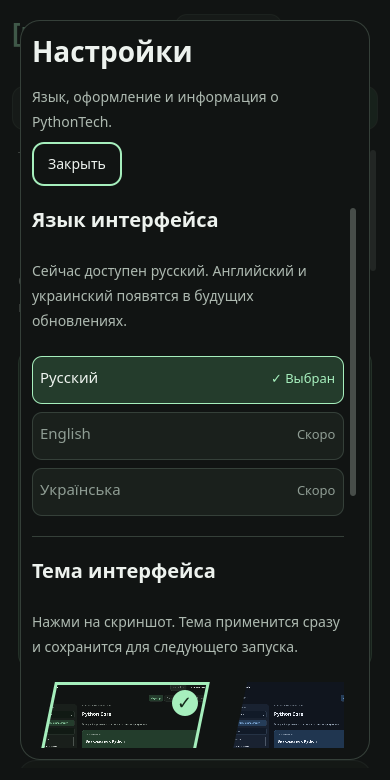
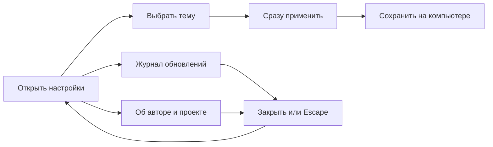
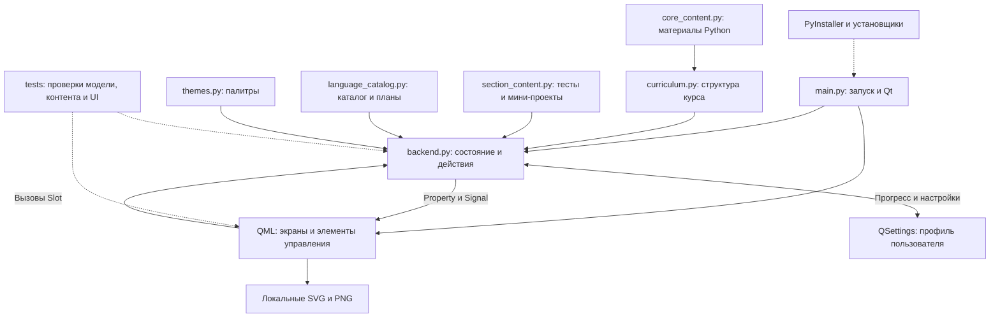
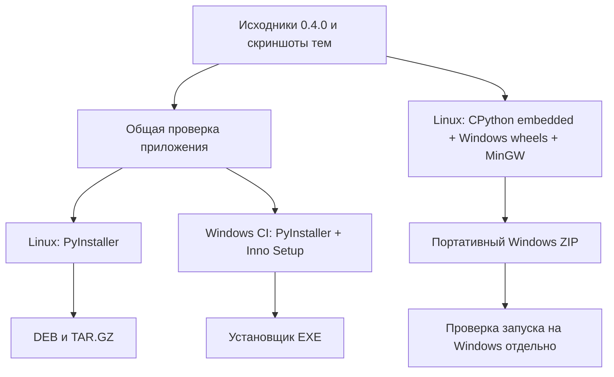

# PythonTech

**Изучение программирования: от понятной теории до своего работающего проекта.**

PythonTech — настольное приложение на русском языке. Оно помогает последовательно изучать темы, разбирать код, решать задания и писать собственные программы. Основной принцип: **объяснять понятно, показывать на примерах и закреплять практикой**.

Проект развивается в платформу для изучения разных языков. Сейчас полностью наполнен **Python Core**, а для ещё девяти языков подготовлены карточки с аватарками и программы будущих курсов.

Приложение работает локально: для обучения не нужны аккаунт, сервер или постоянное подключение к интернету. Интернет потребуется при первоначальной установке зависимостей из исходников.

> Версия в исходниках — **0.4.0**. Автор — **Unbowed / byteix**. Бесплатное обучение с открытым исходным кодом: коротко, понятно, по делу. [Что добавлено и изменено](packaging/RELEASE_NOTES.md).

## Что уже есть

| Возможность | Текущее состояние |
| --- | --- |
| Python Core | 54 урока в 9 разделах по 6 уровней |
| Задания уроков | 108 коротких заданий с автоматической проверкой и обратной связью |
| Самостоятельная практика | 54 задания с подсказками и критериями самопроверки |
| Итоги разделов | 9 тестов: по 6 вопросов и 2 задания на понимание частей кода |
| Мини-проекты разделов | 9 проектов с последовательными подсказками, готовым примером и разбором |
| Каталог языков | 10 языков с локальными аватарками; у будущих курсов можно открыть программу |
| Навигация | Поиск тем, переходы между уроками, продолжение обучения и возврат к разделам |
| Прогресс | Сохранение пройденных уроков, отметок практики, тестов и проектов на компьютере |
| Настройки | Язык интерфейса, четыре темы в ряд с диагональными превью, уменьшение анимации |
| О приложении | Журнал обновлений и информация об Unbowed / byteix |
| Удобство | Адаптация к узкому окну, управление с клавиатуры, прокрутка и уменьшение анимации |
| Примеры | Копирование кода и отдельный рабочий проект трекера привычек |

В теории выделены основные мысли, объяснения разбиты на абзацы, а задания и критерии оформлены отдельными пунктами. Аватарки языков и скриншоты тем включены в приложение и загружаются без интернета.

## Настройки в 0.4.0

Открой «Настройки» в верхней панели. Русский язык уже выбран; **English** и **Українська** показаны серыми с отметкой «Скоро». Эти пункты пока нельзя выбрать. Язык интерфейса не связан с выбором языка программирования на главном экране.

```text
Настройки
│
├── Язык интерфейса     Русский ✓  ·  English — скоро  ·  Українська — скоро
│
├── Тема                / Зелёная / Синяя / Серая / Светлая /
│                       └─ реальные снимки меню, выбор сохраняется
├── Анимация            Меньше анимации
│
└── PythonTech 0.4.0     Журнал обновлений  ·  О разработке
```


На узком экране карточки тем остаются в ряд: прокручивай его вправо или используй стрелки клавиатуры. Tab перемещает фокус, Space/Enter выбирает тему, Escape закрывает верхнее окно и возвращает фокус к кнопке открытия.





Подробнее: [оформление и управление настройками](docs/SETTINGS_DESIGN.md).

## Как проходит обучение

1. **Изучи теорию.** Прочитай короткое объяснение и обрати внимание на основное правило.
2. **Разбери пример.** Посмотри, что делает код и почему получается такой результат.
3. **Ответь на вопросы.** Приложение проверит короткие ответы и даст подсказки при ошибке.
4. **Напиши свой код.** Выполни практику урока в отдельном файле. При необходимости раскрой подсказку.
5. **Заверши шесть уровней.** После успешного разбора заданий всех уроков раздела откроется его итоговая страница.
6. **Пройди тест раздела.** Ответь на шесть вопросов и выбери объяснения для двух фрагментов кода. Нужны восемь верных ответов; количество попыток не ограничено.
7. **Создай мини-проект.** После теста откроются задание, пошаговые подсказки и готовый образец с разбором. Изучи образец и напиши свою версию.
8. **Проверь результат.** Пройди по критериям, отметь выполнение и переходи к следующему разделу.

Уроки можно открывать свободно. Итоговый тест становится доступен после шести пройденных уровней, мини-проект — после теста. Незавершённый итог раздела появляется в продолжении обучения на главном экране курса.

**Автоматическая проверка и самопроверка различаются:** ответы на вопросы проверяет приложение; выполнение собственного проекта отмечает ученик после запуска и проверки программы. Приложение не анализирует произвольный исходный код и не выдаёт автоматическую оценку `.py`-файлу.

Подробнее: [порядок обучения и критерии готовности](docs/CORE_GUIDE.md).

## Программа Python Core

| Раздел | Основные темы | Мини-проект после раздела |
| --- | --- | --- |
| Начало | Переменные, числа, строки, ввод и вывод | Планировщик времени |
| Логика и циклы | Сравнения, условия, while, for, range | Игра «Угадай число» |
| Коллекции данных | Списки, строки, множества и словари | Список покупок |
| Функции и структура | Аргументы, return, области видимости и рекурсия | Конвертер единиц |
| Надёжный код | Модули, файлы, исключения, классы и тесты | Журнал заметок |
| Уверенный Python | Изменяемость, включения, генераторы и декораторы | Отчёт по занятиям |
| Модели и контракты | ООП, dataclass, аннотации и валидация | Каталог объектов |
| Инструменты и данные | Окружение, JSON, CSV, тесты, логи и Git | Отчёт из JSON |
| Самостоятельная практика | Планирование, читаемый код, отладка и законченные программы | Трекер привычек |

В каждом мини-проекте есть учебный образец и отдельная задача на собственную реализацию. В Python также представлены направления **Web** и **NumPy**: пока это планы по 10 тем, без опубликованных уроков. Средний и высокий уровни обучения ещё не реализованы.

## Языки и будущие курсы

| Язык | Для каких задач | Статус |
| --- | --- | --- |
| Python | Автоматизация, данные, серверные программы | Python Core доступен |
| JavaScript | Интерактивные страницы и веб-приложения | Программа курса |
| TypeScript | Типизация и надёжность JavaScript-проектов | Программа курса; предполагает основы JavaScript |
| Java | Серверные системы и объектные приложения | Программа курса |
| C# | .NET, приложения, сервисы и игровая логика | Программа курса |
| C++ | Производительные приложения и управление ресурсами | Программа курса |
| C | Память, указатели и системные основы | Программа курса |
| Go | Сетевые сервисы и инструменты командной строки | Программа курса |
| PHP | Серверная веб-разработка | Программа курса |
| SQL | Запросы и работа с реляционными данными | Программа курса |

У каждого будущего курса описаны цель, шесть предполагаемых разделов и итоговый проект. Это **планы, а не доступные уроки**. Порядок карточек отражает направление развития проекта и не является точным рейтингом популярности.

На следующем этапе каталог планируется расширять: **Rust, Kotlin, Swift, Dart и Ruby**, затем другие специализированные направления. Подробности и источники выбора: [план развития каталога](docs/LANGUAGE_ROADMAP.md).

## Будущие версии

Номера следующих релизов и даты пока не закреплены. Развитие разбито на этапы, чтобы готовые возможности не смешивались с намерениями.

| Этап | Что планируется |
| --- | --- |
| Переводы | Английский и украинский интерфейсы; сейчас эти пункты отмечены «Скоро» |
| Расширение основных курсов | Последовательно наполнить программы популярных языков полноценной теорией, примерами, заданиями и проектами |
| Развитие Python | Наполнить Web и NumPy; затем развивать средний и высокий уровни |
| Единая структура обучения | Сохранять для новых курсов цикл: 6 уровней → тест → мини-проект, с понятной подачей и проверкой отображения |
| Новые специализации | Добавлять Rust, Kotlin, Swift, Dart, Ruby и дальнейшие направления после основных курсов |

Встроенный редактор, запуск пользовательского кода, аккаунты и облачная синхронизация **сейчас отсутствуют**. Их реализация и сроки не включены в утверждённый план выше.

## Архитектура проекта

Приложение состоит из трёх основных частей: **учебные материалы**, **состояние и логика на Python**, **интерфейс Qt Quick/QML**. Отдельного веб-сервера и базы данных для работы курса нет.



### Учебные материалы

- **`curriculum.py`** определяет модели уроков и упражнений, направления, разделы и идентификаторы уровней. Собирает уроки из авторского контента.
- **`core_content.py`** хранит основную теорию Python Core, примеры, объяснения, практику и критерии проверки.
- **`section_content.py`** содержит мини-проекты, подсказки и задания на разбор кода. Шесть вопросов итогового теста берутся из соответствующих уроков, ещё два проверяют понимание фрагментов.
- **`language_catalog.py`** описывает языки, доступность курсов, программы и дальнейшие направления. Добавление карточки само по себе не создаёт новый учебный курс.

### Состояние и логика

**`main.py`** создаёт Qt-приложение, подключает backend к QML и загружает главное окно. Здесь же определена версия и предусмотрен режим `--smoke-test` для проверки запуска сборки.

**`backend.py`** предоставляет QML свойства, сигналы и вызываемые методы через PySide6. Он отвечает за маршруты, проверку ответов, открытие итогов разделов, продолжение обучения, копирование примеров и сохранение результатов.

Постоянные данные сохраняются через **QSettings** в профиле пользователя: пройденные уроки, отметки практики, результаты тестов разделов, отметки проектов, тема и уменьшение анимации. Черновики ответов, подробная обратная связь и позиции прокрутки находятся в памяти текущего сеанса. Облачного хранения нет.

**`themes.py`** задаёт общие роли цветов: фон, поверхность, текст, акцент, границы и состояния элементов. Компоненты используют эти роли, поэтому выбранная тема применяется ко всему интерфейсу.

### Интерфейс

| Компонент | Назначение |
| --- | --- |
| `Main.qml` | Главное окно, шапка, переключение экранов и переходы |
| `Landing.qml` | Каталог языков и вход в готовый курс |
| `LanguageAvatar.qml`, `LanguagePlan.qml` | Аватарки и окно программы будущего курса |
| `Sidebar.qml` | Направления, темы, поиск и навигация |
| `CourseView.qml` | Прокручиваемая область и загрузка страницы по маршруту |
| `Overview.qml`, `SectionPage.qml` | Обзор курса и список уровней раздела |
| `LessonPage.qml` | Теория, пример, упражнения, подсказки и практика |
| `CheckpointPage.qml` | Итоговый тест, выбор объяснений кода и мини-проект |
| `RoutePage.qml`, `Mountain.qml` | Объяснение учебного маршрута и его иллюстрация |
| `SettingsMenu.qml` | Выбор темы по скриншотам и настройка анимации |
| `Copy.qml`, `Card.qml`, `AppButton.qml` | Общие компоненты текста, карточек и кнопок |
| `AppComboBox.qml`, `AppScrollBar.qml`, `FastScroll.qml` | Списки выбора и прокрутка |

### Примеры, проверки и сборка

**`examples/habit_tracker/`** — отдельное консольное приложение для самостоятельного изучения. `service.py` содержит правила работы с привычками, `storage.py` — чтение и запись JSON, `__main__.py` — команды CLI. Оно не хранит прогресс учебного приложения.

**`tests/`** проверяет учебные материалы, модель состояния, навигацию QML, итоги разделов и пример трекера. Проверки используют временные данные.

**`packaging/`** содержит конфигурацию PyInstaller, сборку Linux-пакетов, сценарий Inno Setup для Windows, сведения о лицензиях и описание релиза. Workflow GitHub Actions запускается вручную, выполняет проверки, собирает приложение на Windows и Linux и может публиковать релиз по отдельному параметру запуска.

## Структура файлов

```text
PythonTech/
├── main.py                       # Точка входа и версия
├── backend.py                    # Состояние, маршруты и проверка ответов
├── curriculum.py                 # Модели и структура курсов
├── core_content.py               # Материалы Python Core
├── section_content.py            # Итоги разделов и мини-проекты
├── language_catalog.py           # Языки и программы будущих курсов
├── themes.py                     # Четыре палитры
├── requirements.txt              # Зависимость PySide6
├── qml/                          # Экраны и общие компоненты интерфейса
│   ├── icons/languages/          # SVG-аватарки и лицензия Devicon
│   └── previews/                 # Скриншоты четырёх тем
├── examples/habit_tracker/       # Рабочий учебный CLI-проект
├── tests/                        # Автоматические проверки
├── tools/capture_theme_previews.py # Обновление скриншотов тем
├── docs/
│   ├── CORE_GUIDE.md             # Порядок обучения
│   ├── LANGUAGE_ROADMAP.md       # Развитие каталога
│   └── SETTINGS_DESIGN.md        # Устройство настроек
├── packaging/                    # Сборка и установщики
├── .github/workflows/build.yml   # Проверки, сборка и публикация
├── AGENTS.md                     # Правила работы с текстом и интерфейсом
└── LICENSE                       # Лицензия проекта
```

Каталоги `build/` и `dist/` создаются при сборке; виртуальные окружения и локальные материалы дизайна не относятся к исходному коду приложения.

## Запуск из исходников

Нужен **Python 3.10+**. Интерфейс использует **PySide6 6.8.2.1 и Qt Quick**; React, браузерный frontend и Node.js для запуска не нужны. В конфигурации CI используется Python 3.12.

```sh
git clone https://github.com/unbowed-scripts/PythonTech.git
cd PythonTech
python -m venv .venv
```

**Linux / macOS:**

```sh
.venv/bin/python -m pip install -r requirements.txt
.venv/bin/python main.py
```

**Windows:**

```powershell
.venv\Scripts\python.exe -m pip install -r requirements.txt
.venv\Scripts\python.exe main.py
```

Если команда `python` недоступна, используй `python3` на Linux/macOS или `py` на Windows. На Linux также нужны системные библиотеки Qt; список для CI указан в [workflow сборки](.github/workflows/build.yml). Отдельная сборка и проверка macOS в CI пока не настроены.

## Установщики

Ищи опубликованные сборки и их описание в [GitHub Releases](https://github.com/unbowed-scripts/PythonTech/releases). В проекте настроена подготовка:

- Windows x64 — установщик через Inno Setup;
- Linux x64 — пакет `.deb` и переносимый архив `.tar.gz`.

Сборки включают Python и Qt для самого приложения. Для выполнения учебных заданий в собственных файлах нужен отдельно установленный Python. Установщики пока не подписаны сертификатом издателя.

Версия приложения, конфигурация установщика и описание релиза согласованы на 0.4.0. Скачанные старые сборки не обновляются автоматически. Локальные артефакты находятся в `dist/installers/`.

Портативная Windows-сборка создаётся командой `python packaging/windows_portable.py` на Linux при наличии MinGW-w64. Распакуй ZIP целиком и запусти `PythonTech.exe`, сохранив рядом папку `app`. Python включён в архив. Проверка запуска на Windows выполняется отдельно; сборка ZIP на Linux её не заменяет. Windows CI создаёт установщик Inno Setup.

Локальный Linux-пакет требует версию glibc системы сборки или новее (точная зависимость записана в `.deb`). Для более широкой совместимости используй сборку CI на Ubuntu 22.04.

## Пример: трекер привычек

Из корня проекта, интерпретатором выбранного окружения:

```sh
python -m examples.habit_tracker --help
python -m examples.habit_tracker add "Учить Python"
python -m examples.habit_tracker list
```

Команды позволяют добавлять привычки, просматривать их ID, отмечать даты и удалять записи. По умолчанию данные записываются в `habits.json`; путь можно задать параметром `--file`. Сначала попробуй собственную реализацию, затем сравни её с примером.

## Проверка и обслуживание

Команды ниже выполняются из корня проекта интерпретатором, в котором установлен PySide6.

```sh
# Полная проверка
python -m unittest discover -s tests -v

# Небольшая проверка итогов раздела и кнопок
python -m unittest discover -s tests -p test_checkpoint.py -q

# Проверка запуска приложения
python main.py --smoke-test

# Обновление локальных скриншотов тем
python tools/capture_theme_previews.py
```

В headless-окружении для Qt используются `QT_QPA_PLATFORM=offscreen` и `QT_QUICK_BACKEND=software`. Скрипт обновления скриншотов использует временные настройки и не меняет пользовательский прогресс.

При добавлении учебных материалов сохраняй стабильные идентификаторы существующих уроков, проверяй примеры и разделяй готовые курсы и планы. При изменении интерфейса следуй [правилам проекта](AGENTS.md): изучай документацию UI/UX, сохраняй понятную подачу и проверяй обычную и узкую ширину окна.

## Как собирается релиз



Сборка сама по себе не публикует релиз. Для публикации в GitHub Actions есть отдельный параметр `publish_release`.

## Лицензия

Код проекта распространяется по [MIT](LICENSE). Qt, PySide6 и другие компоненты имеют собственные условия распространения — см. [уведомления о сторонних компонентах](packaging/THIRD_PARTY_NOTICES.md).

Аватарки языков взяты из Devicon; лицензия включена в [каталог изображений](qml/icons/languages/DEVICON-LICENSE.txt). SQL использует собственный нейтральный символ базы данных. Названия и логотипы языков принадлежат их правообладателям.
