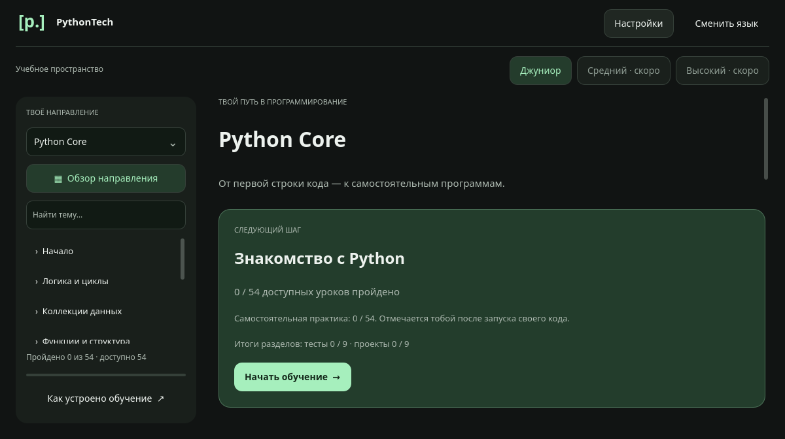
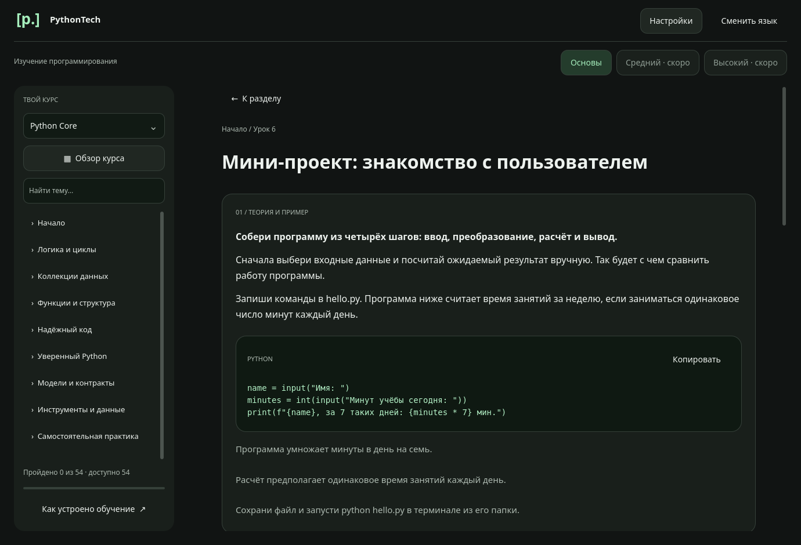

<div align="center">

# PythonTech

**Learn Python. Understand the code. Build your own project.**

**English** · [Русский](README.ru.md) · [Українська](README.uk.md)

[Downloads](https://github.com/unbowed-scripts/PythonTech/releases) · [Quick start](#quick-start) · [Learning workflow](#learning-workflow) · [Development](#technology-and-development)

</div>



PythonTech is a free desktop app for learning Python through short explanations, runnable examples and guided practice. Lessons work offline without an account, and progress stays on your computer.

> **Language availability:** these READMEs are available in English, Russian and Ukrainian. The app interface and published lessons are currently in Russian. English and Ukrainian interfaces are planned.

## From basics to a working project

| Python Core | Python Web |
| --- | --- |
| **54 lessons · 9 sections** | **42 lessons · 7 sections** |
| Variables, loops, collections, functions, files, classes and tests | HTTP, Flask, SQL relations, accounts, permissions, testing and deployment basics |
| Final project: a habit tracker | Three apps: notes, a book catalog and personal tasks |

**96 lessons · 192 lesson questions · 16 section tests · 16 mini-projects**

- **Learn by doing.** Each lesson includes theory, a code example, an explanation and independent practice.
- **Get useful feedback.** Retry answers, open step-by-step hints and copy example code.
- **Continue at your pace.** Lesson progress, passed tests and practice marks persist between launches.
- **Choose your workspace.** Four themes, a narrow-window layout, keyboard navigation and reduced motion.
- **Connect AI if needed.** Use your own compatible model; built-in hints remain available offline.

NumPy and other programming languages currently have course outlines, not published lessons.

<details>
<summary><strong>Look inside a lesson</strong></summary>



The screenshots show the actual Russian interface.

</details>

## Quick start

### Download an app build

Choose an available package on the [Releases page](https://github.com/unbowed-scripts/PythonTech/releases). The source version is **0.7.0**; published installers may have a different version.

Course compression, on-demand loading, and progress compatibility are described in [storage notes (Russian)](docs/STORAGE.md).

- **Windows:** run the installer, or extract the entire portable archive and open `PythonTech.exe`. Keep its accompanying files together.
- **Linux:** install the `.deb` package, or extract the archive and launch `PythonTech` from its directory.

### Run from source

Use **Python 3.10+ with support for PySide6 6.8.2.1** and a desktop environment. Internet access is needed to install dependencies.

```bash
git clone https://github.com/unbowed-scripts/PythonTech.git
cd PythonTech
```

**Linux / macOS** — source setup; macOS is not a published build target:

```bash
python3 -m venv .venv
.venv/bin/python -m pip install -r requirements.txt
.venv/bin/python main.py
```

**Windows PowerShell:**

```powershell
py -3 -m venv .venv
.\.venv\Scripts\python.exe -m pip install -r requirements.txt
.\.venv\Scripts\python.exe main.py
```

The commands below use `python` from an activated virtual environment. Activate it with `source .venv/bin/activate` on Linux/macOS or `.\.venv\Scripts\Activate.ps1` in PowerShell. Alternatively, use the full interpreter path shown above.

## Learning workflow

1. Select **Python → Python Core**. Start with Core if you are new to programming; Web lessons are also freely accessible.
2. Read the explanation and example. Answer both questions, then select **«Проверить ответы»** (Check answers).
3. Write the practice task in your own `.py` file. Run it with Python and compare the result with the criteria.
4. Mark the practice as completed after checking it yourself.
5. Finish a section's six lessons to unlock its test. Pass all eight test questions, then complete the mini-project.

**The app checks short answers, not your program.** It does not execute learner code. Practice and project completion are self-reported. Answer drafts and AI questions/code are kept only during the current session.

### Try the Web project

The notes service demonstrates HTML forms, JSON API, SQLite storage, search, editing and deletion. From the repository root:

```bash
python -m pip install -r examples/web_notes/requirements.txt
python -m flask --app examples.web_notes.app run
```

Open [localhost:5000](http://127.0.0.1:5000/). Stop the server with **Ctrl+C**. Flask is only needed to run Web examples, not to read the course or launch PythonTech.

The notes app is the first complete Web project. Continue with the [book catalog](examples/web_catalog/README.md) for relations, search and pagination, then [personal tasks](examples/web_tasks/README.md) for accounts and ownership checks. The final assignment adds your own features, tests and launch instructions. All three examples are intended for local learning. See the [Web learning guide](docs/WEB_GUIDE.md) for the full route and completion criteria (Russian).

## Optional AI tutor

Open **«Настройки → ИИ-помощник»** (Settings → AI tutor). Enter a Chat Completions-compatible API address, model name and your API key, then select **«Подключить и проверить»** (Connect and check).

For a task, open **«Помощь ИИ»** (AI help), optionally paste your code, and request a hint.

| What is sent | What is stored |
| --- | --- |
| A short connection check; task context, example, current answer, pasted code and question when you request a hint | The address and model name persist. The API key stays in memory until disconnect or app exit. |

Requests go directly to your chosen provider; its fees and limits apply. Remote APIs require HTTPS. A separately installed local model may use an address such as `http://localhost:11434/v1` and work without internet. The tutor cannot read local files, execute code or change progress. Check its advice by running your code.

## Technology and development

| Area | Tools |
| --- | --- |
| Desktop application | Python, PySide6 6.8.2.1, Qt Quick / QML |
| Local preferences and progress | Qt `QSettings` |
| Web practice | Flask 3.1+, SQLite, HTML / CSS, JSON |
| Verification | Python `unittest`, Qt Test, layout capture scripts |

```text
main.py / backend.py       Application entry point and state
curriculum.py             Course structure and lesson assembly
core_content.py           Python Core learning content
web_content.py            Core Web lessons and course assembly
web_extended_content.py   Data relations, accounts and delivery
qml/                      Interface, icons and theme previews
examples/                 Runnable learning projects
tests/ / tools/           Tests and development utilities
docs/ / packaging/        Guides and build scripts
```

After installing both dependency files above, run the test suite:

```bash
python -m unittest discover -s tests -v
```

For a headless Linux run, prefix that command with `QT_QPA_PLATFORM=offscreen QT_QUICK_BACKEND=software`.

For a contribution, read [AGENTS.md](AGENTS.md), keep changes focused and include relevant checks. Report reproducible bugs through [GitHub Issues](https://github.com/unbowed-scripts/PythonTech/issues); omit API keys and personal data.

<details>
<summary><strong>Troubleshooting</strong></summary>

- **The app does not start:** use the same virtual environment for dependency installation and launch; it must include Qt Quick from PySide6.
- **`No module named flask`:** install `examples/web_notes/requirements.txt` with the Python interpreter used for the example.
- **Port 5000 is busy:** add `--port 5001` to the Flask command and open [localhost:5001](http://127.0.0.1:5001/).
- **AI connection fails:** check the address, model identifier, key and provider limits. You can continue learning offline.
- **An answer is rejected:** check letter case and spaces within the answer. Leading and trailing spaces are ignored.

</details>

## Project links and license

[Release notes](packaging/RELEASE_NOTES.md) · [Core project guide](docs/CORE_GUIDE.md) · [Web guide](docs/WEB_GUIDE.md) · [Course roadmap](docs/LANGUAGE_ROADMAP.md)

The linked learning guides are currently in Russian. Maintained by **Unbowed / byteix**. Project code is available under the [MIT License](LICENSE). Dependencies and bundled assets retain their own licenses; see [third-party notices](packaging/THIRD_PARTY_NOTICES.md).
