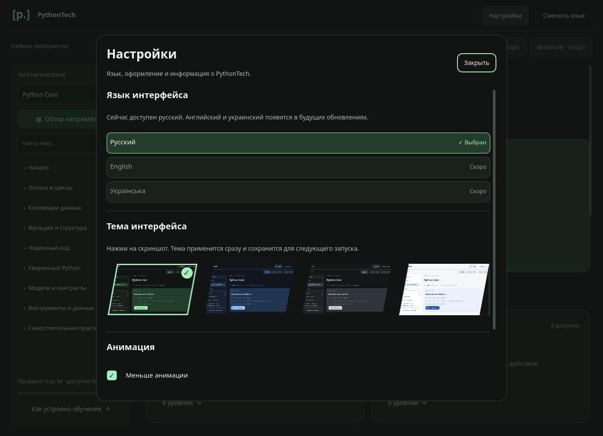
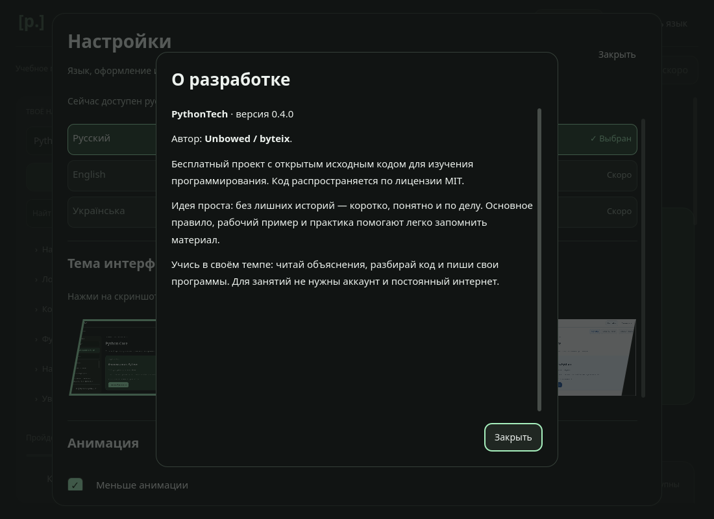

# Настройки оформления

Кнопка «Настройки» в шапке открывает отдельное меню поверх текущего экрана. Урок, ответы и положение прокрутки сохраняются. Тема применяется сразу и сохраняется существующим механизмом QSettings.

Четыре карточки показывают одну и ту же страницу Python Core с боковым меню в разных темах. Это настоящие снимки QML-интерфейса, а не рисунки. Команда `.venv/bin/python tools/capture_theme_previews.py` обновляет `qml/previews/*.png` с временными настройками, не затрагивая пользовательские данные. Папка QML целиком включается в сборку приложения, вместе с изображениями.

Выбор обозначен контуром самого изображения и галочкой поверх него. Внешних прямоугольных карточек и подписей снизу нет; название темы доступно во всплывающей подсказке и для экранного диктора. Карточки доступны через Tab и Space/Enter; при фокусе за пределами видимой области меню прокручивается. Escape и «Закрыть» возвращают к исходному экрану и кнопке открытия. На широкой панели все четыре темы расположены в один ряд. На узком экране ряд прокручивается горизонтально; фокус автоматически выводит карточку в видимую область. Стрелки ← → перемещают фокус между темами. Скриншоты остаются прямыми, их углы закрыты диагональными масками в цвет фона настроек. Настройка уменьшения анимации находится в этом же меню.

## Использованная документация

- [Material Design 3 — Layout](https://m3.material.io/foundations/layout/canonical-examples/overview): сетка карточек адаптируется к доступному месту; отдельная панель поверх основного экрана помогает сосредоточиться на выборе.
- [Radix — Color](https://www.radix-ui.com/themes/docs/theme/color): семантические цвета поверхности, текста, акцента и состояний. Существующие палитры сохранены.
- [Radix — Typography](https://www.radix-ui.com/themes/docs/theme/typography): последовательная иерархия заголовков и основного текста через общие компоненты.
- [Apple HIG — Settings](https://developer.apple.com/design/human-interface-guidelines/settings): общие параметры приложения собраны в отдельной области настроек.
- [Tailwind — Responsive design](https://tailwindcss.com/docs/responsive-design): адаптация к доступному месту: горизонтальная прокрутка ряда тем на узком экране, все четыре карточки на широком. Принцип перенесён в QML без подключения CSS-библиотеки.

Motion for React не применяется: проект использует PySide6 и Qt Quick, не React.

## Язык интерфейса

Доступен русский. English и Українська показаны неактивными с надписью «Скоро», без переключения и ложного сохранения несуществующего перевода. Это отдельная настройка, не каталог языков программирования.

## Журнал и автор

«Журнал обновлений» показывает изменения 0.5.0 и историю 0.4.0. В 0.5.0 добавлены Python Web и подключение своей ИИ-модели. «О разработке» содержит имя Unbowed / byteix, лицензию MIT и идею бесплатного обучения без лишних историй. Оба окна прокручиваются, закрываются через Escape и возвращают фокус к своей кнопке. Учебный прогресс не меняется.

## Источники упаковки

- [CPython: встраиваемый пакет Windows](https://docs.python.org/3.12/using/windows.html#the-embeddable-package).
- [Qt for Python: PyInstaller](https://doc.qt.io/qtforpython-6/deployment/deployment-pyinstaller.html).
